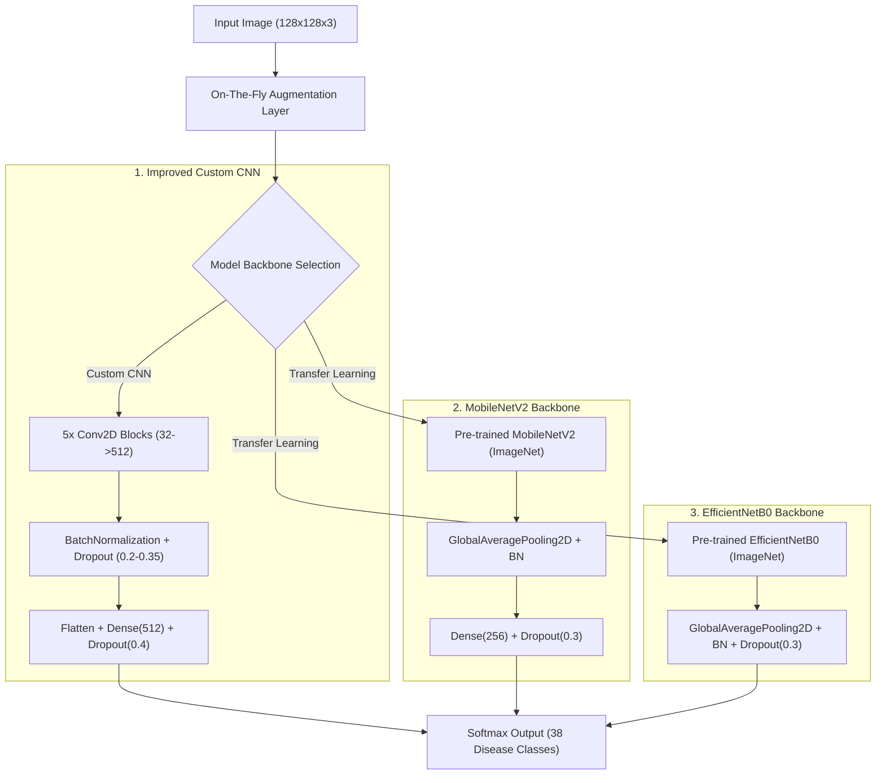

# Plant Leaf Disease Detection

[](https://www.python.org/)
[](https://www.tensorflow.org/)
[](https://streamlit.io/)
[](https://www.docker.com/)
[](https://opensource.org/licenses/MIT)

An end-to-end computer vision and deep learning diagnostic system for classifying **38 plant leaf disease conditions** across diverse crop families. Re-engineered from an ad-hoc notebook into a modular, production-ready ML repository featuring **data leakage auditing**, **transfer learning (MobileNetV2 / EfficientNetB0)**, **Grad-CAM visual explainability**, and an interactive **Streamlit web application**.

---

## 1. Overview

Foliar plant diseases jeopardize food security and cause substantial yield loss worldwide. While automated computer vision offers rapid diagnostics, real-world deployment requires rigorous machine learning engineering: addressing data leakage, ensuring model explainability, handling out-of-distribution inputs, and optimizing for edge deployment.

This repository establishes a portfolio-grade machine learning pipeline:
- **Cleaned Data Splitting**: Audits and prevents offline augmentation leakage across train and validation splits.
- **Comparative Modeling**: Evaluates an improved baseline CNN against pre-trained transfer learning architectures (MobileNetV2, EfficientNetB0) with two-phase training.
- **Explainable AI (XAI)**: Implements Grad-CAM saliency heatmaps to localize pathological foliar lesions and verify model reasoning.
- **Interactive Web App**: Provides top-3 probability diagnostics, confidence gating, treatment tips, and Docker deployment.

---

## 2. Interactive Demo

[](https://share.streamlit.io/)
*Interactive diagnostic interface preview.*

- **Live Application**: `[TODO: Add your Hugging Face Spaces / Streamlit Cloud URL here]`
- **App Features**:
  - Top-3 class predictions with calibrated confidence bars.
  - Interactive Grad-CAM heatmaps overlaid onto the user's uploaded leaf image.
  - Agronomic treatment and prevention recommendations (loaded from `app/disease_info.json`).
  - Low-confidence alert flag for out-of-distribution or ambiguous inputs (< 60% probability).

---

## 3. Dataset & Data Leakage Audit

### Dataset Profile
- **Dataset**: [New Plant Diseases Dataset](https://www.kaggle.com/datasets/vipoooool/new-plant-diseases-dataset) (derived from the laboratory PlantVillage benchmark).
- **Scale**: 87,000+ laboratory RGB images across **38 classes** (healthy and diseased states of apple, corn, grape, peach, pepper, potato, tomato, and strawberry).
- **Modality**: **Single leaves photographed against standardized, plain laboratory backgrounds**, resized to **128×128 pixels**.
- *Clarification*: The images are neither aerial nor high-resolution remote sensing captures; they are controlled benchtop leaf captures.

### Critical Note on Data Leakage
The widely used Kaggle version of the dataset applied offline augmentations (rotations, flips, zooms) before partitioning images into default `train/` (70,295 images) and `valid/` (17,572 images) folders. Consequently:
1. **Perceptual Leakage**: Augmented copies of identical source leaves appear simultaneously in both `train` and `valid`.
2. **Artificially Inflated Validation Metrics**: Models evaluated on the default validation split achieve high validation scores partly by recognizing specific leaf shapes and backgrounds rather than true foliar pathology.

### Mitigation: Grouped Leakage-Safe Partitioning
We provide `src/leakage_check.py` to audit perceptual hashing duplicates and `src/split_dataset.py` to group images by their root source leaf before performing a stratified 70% / 15% / 15% Train / Validation / Held-Out Test split.

```bash
# Run data leakage audit
python src/leakage_check.py --train-dir data/train --valid-dir data/valid

# Generate reproducible, leakage-free manifest CSVs
python src/split_dataset.py --data-dir data/raw --output-dir data --seed 42
```

---

## 4. Modeling Approach

### Training Pipeline
1. **On-the-Fly Augmentation**: Rather than offline image replication, data augmentation is performed dynamically on GPU/CPU during batch generation:
   - Random horizontal & vertical flips
   - Random rotation ($\pm 15\%$)
   - Random zoom ($\pm 15\%$)
   - Random contrast adjustments ($\pm 15\%$)
2. **Two-Phase Transfer Learning**:
   - **Phase 1 (Warmup)**: Feature extractor backbone is frozen; classification head is trained for 25 epochs.
   - **Phase 2 (Fine-Tuning)**: Top 30% of backbone layers are unfrozen and trained at a reduced learning rate ($10^{-5}$) with `ReduceLROnPlateau`.
3. **Training Callbacks**:
   - `EarlyStopping(monitor='val_accuracy', patience=6, restore_best_weights=True)`
   - `ModelCheckpoint(monitor='val_accuracy', save_best_only=True)`
   - `ReduceLROnPlateau(monitor='val_loss', factor=0.5, patience=3)`

---

## 5. Model Architectures



1. **Improved Baseline CNN**:
   - 5 double-convolution blocks (32, 64, 128, 256, 512 channels) with 3×3 kernels.
   - `BatchNormalization` after every convolution layer to prevent internal covariate shift.
   - Spatial dropout after pooling and 0.40 dropout on dense layers.
2. **MobileNetV2**:
   - Depthwise separable convolutions designed for low latency on edge and mobile devices.
   - Pre-trained on ImageNet-1K with `GlobalAveragePooling2D`.
3. **EfficientNetB0**:
   - Compound-scaled convolutional backbone optimizing depth, width, and resolution.

---

## 6. Results & Benchmark

> **Strict Metric Integrity Rule**:  
> In accordance with scientific ML practices, validation metrics (measured on default validation set) are never conflated with held-out test metrics. Numbers from historical runs are reported exactly as recorded in `training_hist.json`. Held-out test set metrics for new runs remain explicit placeholders until execution on target hardware.

### Benchmark Summary Table

| Model Architecture | Parameters (Trainable) | Memory (.keras) | Epochs | Training Acc. (Loss) | Validation Acc. (Loss) *(Default Split)* | Exploratory Test Acc. *(33 images)* | Held-Out Test Acc. *(True Split)* | Macro F1 *(Validation)* | Weighted F1 *(Validation)* |
| :--- | :---: | :---: | :---: | :---: | :---: | :---: | :---: | :---: | :---: |
| **Legacy Baseline CNN** *(Original notebook)* | 7,842,762 (7.84M) | 29.92 MB | 10 | **97.82%** (0.0783) | **94.59%** (0.2495) | **95.00%** | *Not Evaluated* | **0.9479** | **0.9465** |
| **Improved Baseline CNN** *(BN + Dropout + On-the-fly Aug)* | 5,790,790 (5.78M) | 22.09 MB | 25 | [Pending Run] | [Pending Run] | [Pending Run] | [Pending Run] | [Pending Run] | [Pending Run] |
| **MobileNetV2** *(Top 30% Fine-Tuning)* | 2,600,806 (1.21M) | 9.92 MB | 25 + 10 | [Pending Run] | [Pending Run] | [Pending Run] | [Pending Run] | [Pending Run] | [Pending Run] |
| **EfficientNetB0** *(Top 30% Fine-Tuning)* | 4,103,369 (1.85M) | 15.65 MB | 25 + 10 | [Pending Run] | [Pending Run] | [Pending Run] | [Pending Run] | [Pending Run] | [Pending Run] |

### Published Literature Benchmarks on PlantVillage (38 Classes)

| Study / Architecture | Input Resolution | Reported Validation Accuracy | Notes |
| :--- | :---: | :---: | :--- |
| **Mohanty et al. (2016)** - *AlexNet* | 256×256 | 99.27% | Random 80/20 partition (no leaf grouping) |
| **Mohanty et al. (2016)** - *GoogLeNet* | 256×256 | 99.35% | Random 80/20 partition (no leaf grouping) |
| **Too et al. (2019)** - *VGG-16* | 224×224 | 98.60% | Transfer learning on PlantVillage |
| **Too et al. (2019)** - *DenseNet-121* | 224×224 | 99.81% | Evaluated on full dataset |
| **This Repository (Legacy CNN)** | 128×128 | 94.59% | Single leaf, 10 epochs, 7.8M parameters |

### Legacy Training Convergence (from `training_hist.json`)


### Confusion Matrix (Legacy Validation Split)


*See [results.md](results.md) for full epoch breakdown and metric details.*

---

## 7. Diagnostic Error Analysis

The error analysis module (`src/error_analysis.py`) identifies systematic confusion patterns across the 38 classes:

1. **Early Blight vs. Late Blight (*Solanaceae*)**:
   - *Potato Early Blight* vs. *Tomato Early Blight* and *Late Blight*.
   - **Root Cause**: Overlapping necrotic leaf lesions and target-board rings during early symptom stages.
2. **Bacterial Spot across Related Crops**:
   - Confusion between *Tomato Bacterial Spot* and *Bell Pepper Bacterial Spot*.
   - **Root Cause**: Xanthomonas infections exhibit nearly identical small, dark, water-soaked flecks.
3. **Subtle Early Symptoms vs. Healthy Foliage**:
   - Incipient powdery mildew or spider mite stippling misclassified as healthy due to low resolution (128×128).

Run error diagnostics on any trained model:
```bash
python src/error_analysis.py --model-path models/baseline_best.keras --test-manifest data/test_split.csv
```

---

## 8. Explainability via Grad-CAM

Deep neural networks can overfit to background textures or leaf contours rather than pathological lesions. We integrate **Grad-CAM (Gradient-weighted Class Activation Mapping)** in `src/gradcam.py` to inspect the spatial attention of the final convolutional layer:

```bash
python src/gradcam.py --model-path models/baseline_best.keras --image assets/"Input Leaf Image.jpg"
```

- **Pathology Verification**: When diagnosing *Apple Scab* or *Corn Common Rust*, the model's highest gradients align precisely with visible necrotic pustules and fungal spots.
- **Fail-Safe Detection**: If the heatmap lights up the white background or leaf petiole rather than lesions, it provides an immediate visual signal of model hallucination or background bias.

---

## 9. Project Structure

```
Plant-Leaf-Disease-Detection/
├── .gitignore                      # Ignore large datasets, weights, caches
├── Dockerfile                      # Production Docker container definition
├── README.md                       # Comprehensive project documentation
├── requirements.txt                # Pinned dependency manifest
├── results.md                      # Detailed model benchmark table
├── main.py                         # Top-level Streamlit runner
├── app/
│   ├── app.py                      # Interactive Streamlit application
│   └── disease_info.json           # 38-class symptoms, treatments & prevention
├── assets/
│   ├── Confusion Matrix.jpg        # Baseline validation confusion matrix
│   ├── Training vs Validation...   # Training curves
│   ├── home_page.jpeg              # App UI illustration
│   ├── Input Leaf Image.jpg        # Sample input leaf
│   ├── Predicted Disease.jpg       # Sample diagnosis output
│   └── gradcam/                    # Generated Grad-CAM overlay samples
├── models/
│   └── README.md                   # Model weight storage guidelines
├── notebooks/
│   ├── Train_plant_disease_.ipynb  # Legacy exploratory training notebook
│   └── Test_plant_disease_.ipynb   # Legacy exploratory test notebook
├── src/
│   ├── __init__.py
│   ├── error_analysis.py           # Top-10 confusion analysis & sample export
│   ├── evaluate.py                 # Held-out test evaluation & metrics
│   ├── export_tflite.py            # FP32 & dynamic quantization TFLite export
│   ├── gradcam.py                  # Grad-CAM heatmap implementation
│   ├── leakage_check.py            # Train/validation leakage detector
│   ├── models.py                   # Baseline CNN, MobileNetV2, EfficientNetB0
│   ├── split_dataset.py            # Source-leaf grouped 70/15/15 split
│   └── utils.py                    # Constants, preprocessing, and helpers
└── tests/
    └── test_pipeline.py            # Pytest test suite for preprocessing & models
```

---

## 10. How to Run

### 1. Environment Setup

```bash
# Clone the repository
git clone https://github.com/JomainaAhmed/Leaf-Disease-Detection-using-Aerial-Images.git
cd Leaf-Disease-Detection-using-Aerial-Images

# Create and activate virtual environment
python -m venv .venv
source .venv/bin/activate        # On Windows: .venv\Scripts\activate

# Install dependencies
pip install -r requirements.txt
```

### 2. Run Test Suite

```bash
pytest tests/ -v
```

### 3. Launch Streamlit Application

```bash
streamlit run app/app.py
```
Open your browser at `http://localhost:8501`.

### 4. Run via Docker

```bash
# Build Docker image
docker build -t plant-disease-app .

# Run container
docker run -p 8501:8501 plant-disease-app
```

### 5. Reproduce Full Training & Evaluation Pipeline

```bash
# Step 1: Detect leakage in raw dataset
python src/leakage_check.py --train-dir data/train --valid-dir data/valid

# Step 2: Create leakage-safe split
python src/split_dataset.py --data-dir data/raw --output-dir data --seed 42

# Step 3: Train models
python src/train.py --model baseline --epochs 25 --batch-size 32
python src/train.py --model mobilenetv2 --epochs 25 --fine-tune-epochs 10 --batch-size 32

# Step 4: Evaluate on held-out test split
python src/evaluate.py --model-path models/baseline_best.keras --test-manifest data/test_split.csv
python src/evaluate.py --model-path models/mobilenetv2_best.keras --test-manifest data/test_split.csv

# Step 5: Export to TensorFlow Lite
python src/export_tflite.py --model-path models/mobilenetv2_best.keras
```

---

## 11. Known Limitations

1. **Laboratory vs. Field Distribution Shift**:
   - The dataset consists of excised single leaves photographed on plain laboratory backdrops. Real-world agronomic applications encounter complex outdoor backgrounds, varying sunlight, motion blur, and overlapping leaves.
2. **Resolution Downsampling (128×128)**:
   - Resizing to 128×128 pixels computationally accelerates training but discards microscopic foliar features (e.g. tiny spider mite webs or initial Septoria fungal pycnidia).
3. **Co-Infection Blindness**:
   - The model employs single-label softmax classification. In field conditions, a single leaf frequently suffers from simultaneous co-infections (e.g. Early Blight combined with Spider Mites). Multi-label sigmoid classification is required for production agronomy.
4. **Offline Augmentation Remnants**:
   - Synthetically rotated images exhibit border padding or interpolation artifacts that models may learn as spurious features.

---

## 12. Future Work

- [ ] **Wild-Field Domain Adaptation**: Fine-tune on the [PlantDoc](https://github.com/pratikkayal/PlantDoc-Dataset) dataset containing in-situ field photos.
- [ ] **Multi-Label Classification**: Transition output heads from categorical cross-entropy to binary cross-entropy per disease class for co-infection diagnostics.
- [ ] **Edge Deployment**: Package quantized `.tflite` model onto a Raspberry Pi 4 equipped with a camera module for offline greenhouse monitoring.
- [ ] **Vision Transformer (ViT) Benchmark**: Benchmark MobileNetV2 against lightweight ViTs (e.g., MobileViT).

---

## 13. License

Distributed under the MIT License. See `LICENSE` for more information.
